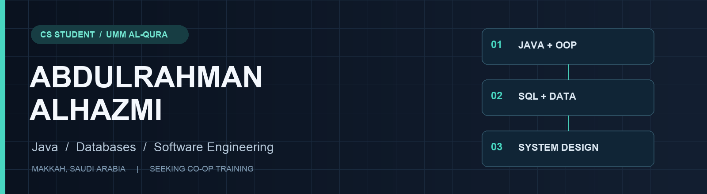
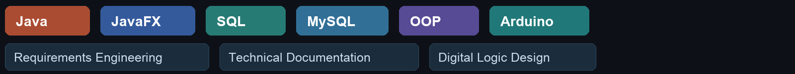
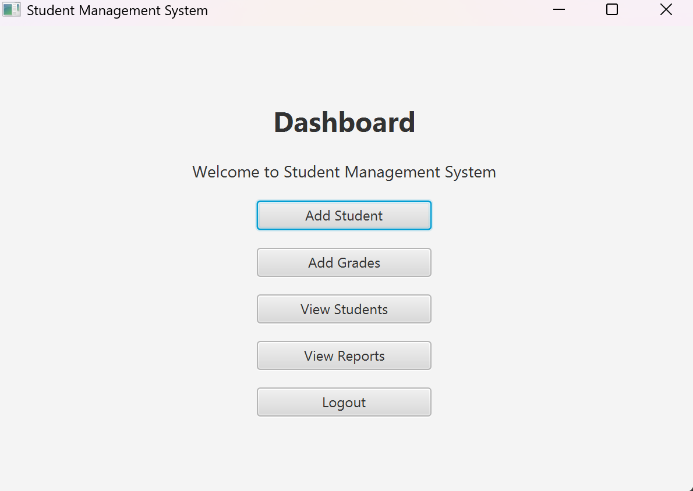

  

<b>Computer Science student · Java and database development · Co-op candidate</b>

طالب علوم حاسب في جامعة أم القرى، أركز على تطوير البرمجيات بلغة جافا، وقواعد البيانات، وهندسة البرمجيات.

  
  

## About me

I study **Computer Science at Umm Al-Qura University**, with an expected graduation date of **June 2028**. Based in **Makkah, Saudi Arabia**, I am seeking co-op training in **Java software development or database development**.

My coursework covers object-oriented programming, data structures and algorithms, database design, software engineering and computer networks. My projects bring together code, relational data, requirements, technical documentation and Digital Logic Design.

## Skills used in my coursework

## Featured projects

### Student and Grade Management System

**Java · JavaFX · FXML · File I/O**

A desktop course project with six screens: login, dashboard, student entry, grade entry, student records and reports. The implementation stores records in local text files and calculates an overall average across numeric grades.

*Screenshot from the original course submission. Compilation and static FXML checks passed; GUI startup and persistence were not independently verified.*

[Explore the project](https://github.com/1Alhazmi/student-grade-manager)

### University Database System

**MySQL · Relational Design · SQL**

A team project modeling students, courses, instructors and enrollments. The work connects an ER diagram and relational schema to primary and foreign keys, constraints, joins, subqueries, aggregates and a view.

**My contribution:** report writing and technical documentation. SQL implementation and schema/ER design are credited to teammates in the project README.

[Explore the project](https://github.com/1Alhazmi/university-database-system)

### Cinema Management System

**Java · Object-Oriented Programming · Exceptions**

A 12-file Java console project modeling movies, seats, a cinema hall, customers, staff and tickets. Demonstrates inheritance, interfaces, polymorphism, collections and domain-specific exceptions. Compiled and ran during preparation.

[Explore the project](https://github.com/1Alhazmi/cinema-management-system)

### Smart To-Do List

**Requirements Engineering · System Modeling · Peer Review**

A three-person software engineering project defining task-management requirements, priorities, reminders and proposed AI-assisted planning. Includes functional and non-functional requirements, context diagrams and use-case diagrams. This is a requirements and design submission.

**My contribution:** requirements definition and peer review; detailed attribution is retained in the project documents.

[Explore the project](https://github.com/1Alhazmi/smart-todo-requirements)

## Hardware and research

| Project | Focus | Type of work |
| --- | --- | --- |
| [Arduino Motion Detection](https://github.com/1Alhazmi/digital-logic-motion-detector) | PIR sensor, digital HIGH/LOW input, LED control | Digital Logic Design final-project report |
| [AI in Cybersecurity](https://github.com/1Alhazmi/ai-in-cybersecurity-research) | Defensive AI, adversarial machine learning, governance | Individual literature-based course research |
| [Simple Operations](https://github.com/1Alhazmi/java-simple-operations) | Console input, loops, conditions and random numbers | Introductory Java course project |

## Portfolio notes

These are academic projects. Team credits and verification limits are recorded in the individual READMEs. Public repositories currently contain project overviews; the prepared source files, reports and diagrams are awaiting upload.

**Languages:** Arabic (native) · English (fluent).
